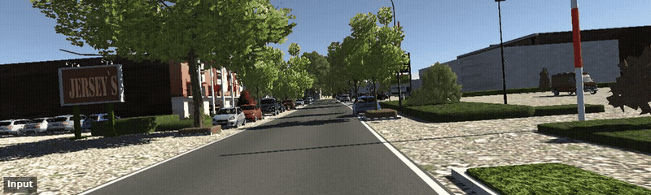

<div align="center">

# ψ-PD: Wavelet Phase Diffusion

### Structurally and Semantically Consistent Sim-to-Real Translation

**Accepted to WACV 2027**

[Kaiwen Wang](https://kaiwenwang.cv/)<sup>1</sup>, [Frank Bieder](https://frank.bieders.de/)<sup>2</sup>, [Yinzhe Shen](https://shenyinzhe.github.io/)<sup>1</sup>, [Carlos Fernandez](https://scholar.google.co.nz/citations?user=OIF2_EMAAAAJ)<sup>1</sup>, [Jan-Hendrik Pauls](https://scholar.google.com/citations?user=0LbD7HUAAAAJ)<sup>1</sup>, [Omer Sahin Tas](https://www.omersahintas.com/)<sup>2</sup>

<sup>1</sup>Karlsruhe Institute of Technology (KIT) &nbsp; · &nbsp; <sup>2</sup>FZI Research Center for Information Technology

[](https://wacv.thecvf.com/Conferences/2027)&nbsp;
[](https://kit-mrt.github.io/Wavelet-Phase-Diffusion/)&nbsp;
[](https://arxiv.org/abs/2607.21628)&nbsp;
[](https://huggingface.co/kaiwen-wang/Wavelet-Phase-Diffusion)

</div>

**ψ-PD changes how a scene looks, not what it contains.** It manipulates phase in the Dual-Tree Complex Wavelet Packet (DT-ℂWPT) domain, so structure stays put while appearance changes. No paired data, no architecture changes, negligible inference overhead. Works on images and videos, globally or per instance.

<table>
<tr><td align="center"><strong>Global translation</strong></td></tr>
<tr><td align="center"></td></tr>
<tr><td align="center"><strong>Instance-level translation</strong></td></tr>
<tr><td align="center"></td></tr>
</table>

## Installation

```bash
git clone https://github.com/kit-mrt/Wavelet-Phase-Diffusion.git
cd Wavelet-Phase-Diffusion
pip install -r requirements.txt
```

Tested with PyTorch 2.4 (CUDA 12.4) and `transformers==4.49.0`. A `Dockerfile` is provided.

## Checkpoints

```bash
bash scripts/download_checkpoints.sh   # -> ./checkpoints
```

Contains ψ-PD LoRAs for FLUX.1-dev and Wan2.2-I2V-A14B (high-/low-noise experts), a w/o-LFR ablation, and 4-step [Wan2.2-Lightning](https://huggingface.co/lightx2v/Wan2.2-Lightning) LoRAs.

Base models (FLUX.1-dev, Wan2.2-I2V-A14B) download to `./models` on first use. FLUX.1-dev is gated: run `huggingface-cli login` first.

## Inference

**Image** (FLUX.1-dev, 50 steps):

```bash
python inference/translate_image.py --input sim.png --output real.png
```

**Video** (FLUX.1-dev translates the first frame, Wan2.2-I2V-A14B the rest; up to 49 frames, 4 steps):

```bash
python inference/translate_video.py --input sim.mp4 --output real.mp4 --prompt "A photorealistic driving scene ..."
```

## Training

```bash
# FLUX.1-dev on bghira/photo-concept-bucket (images are downloaded and cached in ./data/images)
NUM_GPUS=4 bash scripts/train_flux.sh

# Wan2.2-I2V-A14B on zengxianyu/open-sora-pexels-subset, one expert at a time (704x1280, 49 frames)
NUM_GPUS=4 bash scripts/train_wan.sh high
NUM_GPUS=4 bash scripts/train_wan.sh low
```

## Code Structure

```
wpd/          # ψ-PD noise (noise.py) and FLUX / Wan pipelines (pipelines.py)
inference/    # translate_image.py, translate_video.py
train/        # LoRA training
scripts/      # launchers, checkpoint download
diffsynth/    # modified, trimmed DiffSynth-Studio (see NOTICE)
```

## Citation

```bibtex
@article{wang2026wavelet,
  title={Wavelet Phase Diffusion for Structurally and Semantically Consistent Sim-to-Real Translation},
  author={Wang, Kaiwen and Bieder, Frank and Shen, Yinzhe and Fernandez, Carlos and Pauls, Jan-Hendrik and Tas, Omer Sahin},
  journal={arXiv preprint arXiv:2607.21628},
  year={2026}
}
```

## Acknowledgements & License

Built on [DiffSynth-Studio](https://github.com/modelscope/DiffSynth-Studio) (Apache-2.0), [NeuralRemaster](https://github.com/zengxianyu/PPD-examples) and [pytorch_wavelets](https://github.com/fbcotter/pytorch_wavelets).
Code: Apache-2.0 (see `LICENSE`, `NOTICE`). Model weights: CC-BY-NC-4.0.
